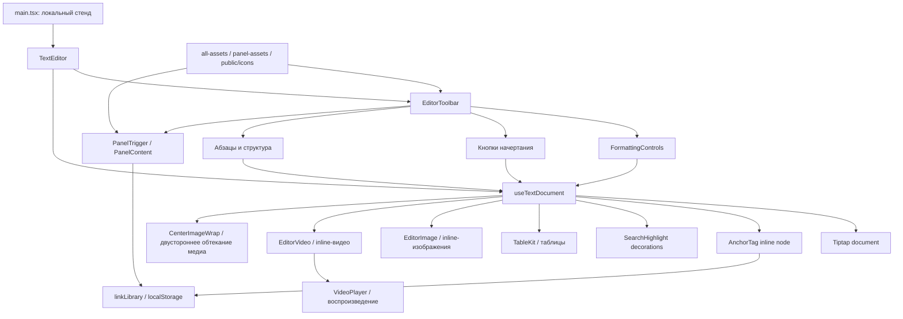

# Карта проекта B2B Text Editor

## Общая схема

`TextEditor` связывает визуальную панель с одним экземпляром Tiptap. `useTextDocument` является источником состояния документа и выполняет команды форматирования. `main.tsx` нужен для стенда и не является частью будущей интеграции редактора.

## Роли файлов

| Путь | Роль | Менять, когда |
|---|---|---|
| `src/main.tsx` | Настройки стенда, галерея состояний, локальная демонстрация | Нужен новый переключатель или сценарий проверки |
| `src/Editor.tsx` | Публичные `TextEditor` и `EditorToolbar`, состав и порядок инструментов | Добавляется инструмент панели или меняется контракт редактора |
| `src/useTextDocument.ts` | Создание Tiptap, чтение inline- и блочного форматирования, команды над выделением | Добавляется реальная функция редактирования |
| `src/AnchorTag.tsx` | Inline-узел якоря, его NodeView, редактирование и удаление внутри текста | Меняется модель, вид или действия тега якоря |
| `src/anchor-tag.css` | Геометрия тега якоря, drag handle и индикатор позиции переноса | Меняется отображение или drag-and-drop якоря |
| `src/TextFormatting.tsx` | Первые три селекта, их варианты Full/Short и окна подтверждения | Меняются тип текста, шрифт, размер или UX селектов |
| `src/ToolPanels.tsx` | Общая оболочка поповеров и визуальные прототипы окон инструментов | Добавляется или уточняется окно инструмента |
| `src/ColorTools.tsx`, `src/color-tools.css` | Интерактивная палитра и выбор цветового действия в компактных вариантах панели | Меняется поведение или вид инструмента цвета |
| `src/linkLibrary.ts` | Общая локальная библиотека URL и якорей, синхронизация открытых экземпляров | Меняется модель или место хранения ссылок |
| `src/link-tools.css` | Окна ссылок, поисковые списки и оформление ссылок в документе | Меняется UX ссылок и якорей |
| `src/table-tools.css` | Окно таблицы, меню действий, сетка ячеек, выделение и изменение ширины | Меняется UX таблиц |
| `src/EditorImage.tsx` | Inline-узел Tiptap и NodeView изображения: размещение, размеры, ссылка, drag handle и окно настройки | Меняется модель или поведение изображения |
| `src/SeoImageSlot.tsx` | Блочный узел Tiptap для SEO-слотов: выбор типа, галерея, последовательное добавление и настройки изображений | Меняется SEO-сценарий Figma `6716:99118` |
| `src/EditorVideo.tsx` | Inline-узел Tiptap и NodeView видео: ссылка, размещение, размер, перенос и настройка | Меняется модель или поведение видео |
| `src/VideoPlayer.tsx` | Проверка адреса, превью, воспроизведение и управление звуком видео | Меняется поддержка источников или плеер |
| `src/CenterImageWrap.tsx` | Блочный узел Tiptap для центрального изображения или видео с редактируемыми областями слева, справа и снизу | Меняется логика двустороннего обтекания |
| `src/image-tools.css` | Окно изображения и его расположение внутри текста и ячеек | Меняется UX изображения |
| `src/seo-image-tools.css` | Выбор и пошаговые состояния SEO-слотов | Меняется UX SEO-изображений |
| `src/video-tools.css` | Окно видео, плеер и его расположение в документе | Меняется UX видео |
| `src/all-assets.ts` | Карта базовых иконок панели | Подключается новая базовая иконка |
| `src/panel-assets.ts` | Иконки и изображения конкретных Figma-окон | Меняется содержимое окна инструмента |
| `src/assets.ts` | Исходная/ограниченная карта части базовых ассетов | Проверять перед удалением; основной редактор использует `all-assets.ts` |
| `src/editor.css` | Геометрия панели, состояния кнопок и размеры иконок | Меняется сама панель или состояние иконки |
| `src/formatting.css` | Селекты, поле Tiptap, типографика и выделение текста | Меняется редактируемый текст или первые три инструмента |
| `src/panels.css` | Поповеры и каталог окон | Меняется окно инструмента |
| `src/stand.css` | Только внешний вид локального стенда | Меняется демонстрационная страница |
| `public/icons/*` | Локальные SVG/PNG, выгруженные из Figma | Добавляется состояние или окно из нового узла Figma |
| `.openai/hosting.json` | Конфигурация будущей публикации стенда | Только на этапе публикации |

## Поток данных редактора

1. `main.tsx` хранит обычный текст в `value` и передаёт его в `TextEditor`. Кнопка демонстрационного текста использует `editorRef`, чтобы вставлять текст через Tiptap без замены медиа обычной строкой.
2. `TextEditor` создаёт `useTextDocument` и передаёт в панель вычисленные состояния форматирования.
3. `useTextDocument` хранит полноценную структуру документа внутри Tiptap.
4. Селекты вызывают `apply(tool, value)`, кнопки начертания — `applyInline(tool)`, палитра — `applyColor(tool, color)`, абзацные инструменты — `applyParagraph(tool, value)`, ссылки и якоря — методы `applyLink`, `createAnchor`, `deleteAnchor`, `renameAnchor` и `updateLinks`, таблицы — `insertTable` и `applyTable`, спецсимволы и эмодзи — `insertSymbol(symbol)`, а редактирование — `search`, `replaceSearch` и `editingAction`.
5. Команда Tiptap применяется к текущему выделению. При пустом выделении mark действует на следующий ввод, а блочная команда — на текущий абзац или пункт списка.
6. `onChange` сейчас возвращает только `editor.getText()`. Поэтому внешний `value` не содержит разметку.

При подключении к целевому макету пункт 6 нужно заменить контрактом JSON/HTML, если форматирование должно переживать сохранение и загрузку.

## Компоненты и контракты

### `TextEditor`

Основной компонент для будущей интеграции. Обязательные свойства:

- `value: string` — внешний обычный текст;
- `onChange(value)` — изменение обычного текста.

Настройки панели:

- `layout`: One, Two или Three;
- `density`: High или Short;
- `tools`: Full или Short;
- `iconSize`: 16 или 20;
- `imageMode`: `standard` или `seo`; выбирает поведение кнопки изображения;
- `state`: фиксированное визуальное состояние;
- `toolbarOnly`: скрывает поле редактора.

### `EditorToolbar`

Можно использовать отдельно для визуального макета. Для рабочего редактора формат, активные marks и обработчики поступают из `TextEditor`.

### `useTextDocument`

Внутренняя точка расширения функционала. Здесь следует подключать новые Tiptap extensions, определять активное состояние инструмента и выполнять команды.

## Состояния и выделение

- Без явного `state` компонент сам определяет Default, Hover, Focused, Typing или Filled.
- `Disabled` делает Tiptap не редактируемым и блокирует кнопки.
- Кнопки начертания предотвращают потерю DOM-выделения на `mousedown`, затем возвращают фокус редактору через цепочку Tiptap.
- `aria-pressed` отражает активность жирного, курсива, подчёркивания и зачёркивания.
- Активное выравнивание и тип списка отражаются в меню; несколько выбранных блоков могут иметь смешанные интервалы.
- `ParagraphStyles` хранит выравнивание, межстрочный интервал и нижний отступ как атрибуты абзаца или заголовка.
- `Color` хранит самостоятельный цвет букв в `textStyle`; `UnderlineColor` хранит цвет букв и линии в mark `underline`, не меняя исходный `textStyle`; `ColorAttributes` хранит фон ячеек и заголовочных ячеек. `ColorPanel` передаёт выбор в `applyColor` без дополнительного подтверждения.
- `AnchorTag` хранит стабильный `anchorId` и название как отдельный атомарный inline-узел. Повторная вставка переносит существующий узел к каретке, а якорная ссылка использует его DOM `id` в `href` с префиксом `#`.
- `SearchHighlight` хранит временные ProseMirror-декорации совпадений. Они не входят в документ, обновляются при изменении поисковых параметров и очищаются при закрытии окна.
- `TableKit` хранит таблицу, строки, ячейки и заголовочные ячейки как узлы документа. Атрибут `borderless` скрывает обводку без удаления структуры, а изменение ширины сохраняется в атрибутах колонок. `MediaBoundaryParagraphs` поддерживает абзацы у границ отдельно стоящих таблиц и медиа-блоков и направляет клик после таблицы в нужную текстовую позицию.
- `EditorImage` хранит изображение как атомарный inline-узел: источник data URL, название файла, режим размещения, положение, размеры и ссылку. Благодаря inline-узлу оно вставляется как в абзац, так и в ячейку таблицы. React NodeView показывает затемнение и ручку переноса при наведении, а центральная кнопка открывает общую панель `ImagePanel` для изменения атрибутов этого же узла. Файл читается только в браузере и не отправляется на сервер.
- `SeoImageSlot` хранит отдельный блочный узел с типом слота и массивом изображений. Одиночный слот и сетка не содержат редактируемого текста; обычные абзацы Tiptap находятся до и после них. У варианта «изображение и текст» один логический текст распределяется между тремя вложенными абзацами Tiptap: слева или справа от картинки и ниже неё. Плагин измеряет доступную ширину и высоту, перераспределяет текст без записи в историю, а картинку пропорционально увеличивает до половины ширины слота, если размеры не заданы вручную. При полной ширине весь текст оказывается под изображением. Старый атрибут `text` мигрирует во вложенный абзац при открытии документа. Селект стенда передаёт `imageMode` через `TextEditor` в панель; в SEO-режиме кнопка вставляет новый слот после выбранного SEO-узла, затем NodeView ведёт шаги загрузки, галереи и настройки. Плавающая панель рендерится Ant Popover в `body`, поверх содержимого редактора. Изображения сохраняются как data URL в атрибутах узла; галерея повторного выбора живёт только в текущей вкладке.
- При выборе «Заливка области» и положения по центру `EditorImage` превращается в `CenterImageWrap`: блок с тремя редактируемыми абзацами слева, справа и под изображением. `paragraphRun` собирает соседние непустые абзацы до пустой строки или другого узла, соединяя их через `hardBreak`; плагин делит содержимое между левой и правой областью с учётом высоты медиа и переносов, остаток идёт ниже. Перенос за ручку восстанавливает исходный текст и создаёт блок обтекания на месте целевого текстового блока. Команды бокового положения и отдельный обработчик переноса ставят inline-медиа в начало целевого блока; пустая строка завершает действие CSS float. Обратная смена режима объединяет содержимое с inline-медиа. Блок допускается также внутри ячейки таблицы.
- `EditorVideo` хранит адрес, размеры, размещение и состояние звука как атрибуты inline-узла. `VideoPlayer` распознаёт YouTube, Vimeo и прямые ссылки на видео; внешние плееры создаются при воспроизведении. Центральное обтекание использует тот же `CenterImageWrap` с атрибутом `kind='video'`; при смене режима он возвращается в inline-узел видео без потери текста.
- `lastEditorText` отличает обратное эхо `value` после внутреннего `onChange` от настоящего внешнего изменения. Благодаря этому ввод в таблице или после неё не заменяет структурированный документ набором обычных абзацев.
- URL и якоря сохраняются в общей библиотеке localStorage независимо от обычного `value`, а применённые marks и цели якорей остаются частью документа Tiptap.
- Списки используют узлы Tiptap `orderedList`, `bulletList` и `listItem`; команды «Сместить вправо/влево» меняют уровень через `sinkListItem` и `liftListItem`.
- Смешанные значения первых трёх селектов отображаются как «Смешанное».

## Ассеты из Figma

- Иконки хранятся локально, чтобы стенд не зависел от временных URL Figma.
- `all-assets.ts` связывает семантические имена иконок с файлами.
- Для состояний одной кнопки могут использоваться отдельные SVG: default, hover/active и active-hover.
- Новую иконку сначала сохранить в `public/icons`, затем добавить в нужную карту или подключить напрямую рядом с таблицей состояний инструмента.

## Что переносить в целевой макет

Переносить:

- `Editor.tsx`;
- `useTextDocument.ts`;
- `TextFormatting.tsx`;
- нужные части `ToolPanels.tsx`;
- связанные CSS и ассеты.

Не переносить как продуктовый код:

- переключатели и галерею из `main.tsx`;
- оформление стенда из `stand.css`;
- каталог прототипов окон, если эти окна ещё не подключены к документу.
